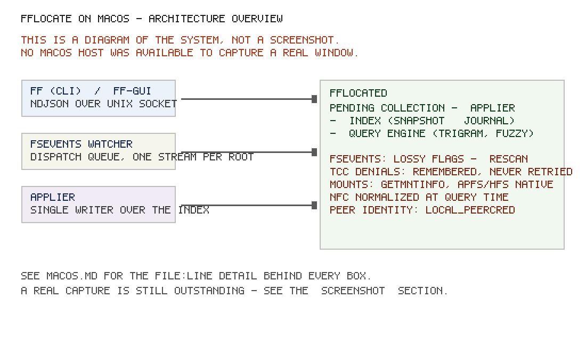

# fflocate on macOS

How the daemon, watcher and query path are built for `target_os = "macos"`, and
what macOS changes compared with Linux. Every claim below is anchored to the
code that implements it; if a behaviour is documented but not implemented, it is
called out as such rather than presented as working.



## Screenshot

**There is no screenshot of the macOS GUI in this document yet, on purpose: the
only macOS image in this repository is a harness render.** `macos-gui.png` is
produced by the GUI test suite and says so in its own status line — *"60 of 60
matches (screenshot fixture: no daemon on this runner)"* — so it shows the
widgets, not the product answering a real query. Publishing it as a product
screenshot would misrepresent it.

The diagram above is likewise a diagram, not a capture. To add a real one:

```sh
cargo build --release -p ff-gui
target/release/fflocated --root ~ --socket ~/Library/Application\ Support/fflocate/fflocate.sock
target/release/ff-gui            # search, then capture the window
```

Replace `docs/screenshots/macos-architecture.png`'s caption in the README only
once a real capture exists.

## Architecture

`ff` and `ff-gui` are clients. They speak the same NDJSON protocol as on Linux,
over a unix socket, to one daemon process (`fflocated`), which owns the index.
There is no macOS-specific client code path: the wire format, cursor model and
query engine are shared.

The parts that *are* macOS-specific are the watcher, the file locations, mount
discovery, and the permission model.

## Watcher: FSEvents

The backend is `crates/fflocate/src/watch/fsevents.rs`, selected automatically
on macOS by `BackendChoice::resolve` (`crates/fflocated/src/config.rs:80-107`).

| Aspect | Behaviour | Where |
|---|---|---|
| API | Hand-rolled FFI — `FSEventStreamCreate`, `SetDispatchQueue`, `Start/Stop/Invalidate`, from `CoreServices`/`CoreFoundation`/`System`. No third-party crate. | `fsevents.rs:126-193` |
| Delivery | Events arrive on a **libdispatch queue** (`dev.fflocate.fsevents`), not a run loop, and are forwarded over a channel that `poll` drains. | `fsevents.rs:207-214`, `:560-577` |
| Granularity | One stream per root, `FileEvents \| NoDefer \| WatchRoot` (`0x16`), latency `0.15 s`, `since = now`. | `fsevents.rs:46-49`, `:296` |
| Path → id | FSEvents reports **paths only**, so `watch_dir` keeps a path→dir-id map; the canonicalized spelling (`/var` → `/private/var`) is registered too. | `fsevents.rs:314-325`, `:535-548` |
| Unresolvable parent | Falls back to a rescan of the nearest known directory with `RescanCause::WatchDropped`. | `fsevents.rs:412-425` |
| Batching | At most `MAX_BATCH = 4096` raw events per `poll`, deduped per `(path, kind)`. | `fsevents.rs:41`, `:347-352` |

Flag mapping (`fsevents.rs:334-436`):

| FSEvents flags | Result |
|---|---|
| `MustScanSubDirs`, `UserDropped`, `KernelDropped`, `EventIdsWrapped` | **rescan the root** (`RescanCause::Overflow`) |
| `RootChanged`, `Mount`, `Unmount` | rescan (`RescanCause::MountEvent`) |
| `ItemRenamed` | `lstat` decides: present → upsert, absent → remove |
| `ItemCreated` / `ItemRemoved` | upsert / remove |
| `ItemInodeMetaMod`, `ItemChangeOwner` | re-read the exec bit only |
| `ItemModified`, `ItemXattrMod`, … | ignored — content changes never reach the index |

That first row is the important one. FSEvents coalesces and can drop events;
drops are turned into an explicit subtree rescan and reported through
`ff stats`, never into a silent gap.

**Not implemented:** `FSEventStreamFlush`, and any `eventIds` bookkeeping — the
stream always starts at "now", so changes made while the daemon was down are
healed by the startup reconcile rather than by replaying FSEvents history
(`fsevents.rs:19-24`).

An explicit `--backend inotify` on macOS is a hard error naming the right
backend, not a silent downgrade to the fake backend
(`crates/fflocated/src/daemon.rs:159-162`).

## File locations

`crates/fflocate/src/config_paths.rs` switches to macOS conventions rather than
XDG (`config_paths.rs:37-100`):

| What | macOS location |
|---|---|
| Socket | `~/Library/Application Support/fflocate/fflocate.sock` |
| Index / state | `~/Library/Caches/fflocate/<format>/` |
| Log (when auto-spawned) | `<state>/fflocated.log` |
| System instance socket | `/var/run/fflocated.sock` |
| System instance state | `/Library/Application Support/fflocate` |

`$XDG_RUNTIME_DIR`, `$XDG_STATE_HOME`, `FFLOCATE_SOCKET` and
`FFLOCATE_STATE_DIR` still override these if set (`config_paths.rs:130-168`,
`:206-219`), which is why the docs describe macOS as following "macOS
conventions **instead of** XDG" — the XDG variables win when present.

`ff` auto-spawns `fflocated` next to itself or on `$PATH`, passing the resolved
socket, state dir and `--backend fsevents` (`crates/fflocate/src/spawn.rs:126-149`,
`:171-188`).

## Mount discovery and default roots

Mounts are read with `getmntinfo(3)` using `MNT_NOWAIT`, so discovering roots
never blocks on a dead network mount (`crates/fflocate/src/mount.rs:196-225`).

* **Native, indexable by default:** `apfs`, `hfs`, `hfsx` (`mount.rs:41-44`).
* **Excluded pseudo-filesystems:** `devfs`, `autofs`, `fdesc`, `none`
  (`mount.rs:107-116`).
* **`/System/Volumes/*` is skipped** — the Data volume is a firmlink of `/`, and
  indexing both would double-count (`mount.rs:66-87`).
* **Network volumes (SMB/NFS/AFP) are never discovered as roots.** They are not
  in the native set, so they are indexed only through an explicit `--root`
  (`mount.rs:41-42`; the non-native assertion is `mount.rs:722-730`). Even then
  a crawl of a parent root does not cross into them — every mount point is a
  boundary (`crates/fflocate/src/applier.rs:682-692`).

With no `--root` and no `$FFLOCATE_ROOT`, the daemon indexes those native mounts;
if discovery finds nothing it falls back to `$HOME` (`crates/fflocated/src/config.rs:251-280`).

## The permission model: TCC, and why denial is permanent

macOS's TCC gate means `read_dir` on Desktop, Documents, Mail and friends fails
with `PermissionDenied` unless the process has Full Disk Access. Two things make
this subtle:

1. **The syscall itself is what raises the dialog.** A watcher-driven loop of
   list → refuse → event → list would re-prompt forever. FSEvents needs no TCC
   grant, so events for a refused folder do keep arriving
   (`applier.rs:1254-1257`).
2. **"May not look" is not "deleted."**

So a refusal is remembered for the life of the process and the folder is never
touched again (`applier.rs:494-507`, `:613-633`):

* the path is inserted into `denied_dirs` once, and the daemon logs
  `not indexing <path>: permission denied (grant Full Disk Access in System
  Settings → Privacy & Security to index it); not retrying` **once**;
* `PermissionDenied` is *not* counted as a transient `read_dir_errors`
  (`applier.rs:1495-1507`; asserted by the regression test at `:2366-2370`);
* events whose parent is denied are dropped **before any `stat`**, so nothing
  inside the folder is ever touched again (`applier.rs:1257-1264`);
* `may_descend` refuses it, so it is never listed, watched or queued
  (`applier.rs:682-687`);
* **entries already in the index stay there** — a denied rescan returns before
  the "indexed but not real ⇒ delete" step (`applier.rs:1690-1700`).

The test `a_permission_denied_directory_is_never_touched_again` counts listings
to prove the second prompt cannot happen (`applier.rs:2317-2437`).

## Names: NFC normalization

APFS and HFS+ hand back decomposed names; a keyboard produces precomposed ones.
`util::normalize_name` / `normalize_text` are NFC-normalizing on macOS and
identity everywhere else (`crates/fflocate/src/util.rs:52-100`).

Normalization is applied at **query time** — `compile_with_case` normalizes the
raw query (`crates/fflocate/src/query.rs:194-197`) — and on the **FSEvents event
path** (`fsevents.rs:344`).

> **Known gap, verified in the source:** the crawl/insert path does *not*
> normalize. `RealFs::read_dir` returns names verbatim (`applier.rs:99-120`) and
> `Index::insert` stores bytes as given (`crates/fflocate/src/index.rs:526-544`).
> The function that does normalize — `crawl::enumerate` at
> `crates/fflocate/src/crawl.rs:47` — has **no live caller**; nothing references
> it outside its own tests. A decomposed name written by an app (rather than by
> the Finder) would therefore be indexed decomposed and missed by a
> precomposed query. See [OPEN ISSUES](#open-issues).

## Case sensitivity

`case_insensitive` is probed per root with a temp-file pair when the root is
writable, falling back to the fstype table (`apfs`/`hfs`/`hfsx` are listed as
case-insensitive) (`mount.rs:103-104`, `:283-320`). It is stored in the snapshot
and surfaced by `ff stats`.

> **Verified:** nothing consumes it for matching. Matching is ASCII
> case-insensitive with smart case, independent of the probed flag; the
> `MatchCtx::fs_case_insensitive` field exists but every construction site sets
> `false` and no evaluator reads it (`query.rs:1627`, `:1736`,
> `expr.rs:1520`, `:1565`, `:2216`). Treat the flag as informational.

## System mode (`--system`)

* Socket at `/var/run/fflocated.sock`, mode `0660`, `chown`ed to the
  `fflocate` group (`crates/fflocated/src/net.rs:73-113`); the group is
  resolved by name through `getgrnam` (macOS OpenDirectory) with an `/etc/group`
  fallback (`config.rs:202-224`).
* Caller identity comes from **`LOCAL_PEERCRED`** (`libc::xucred`), the macOS
  analogue of `SO_PEERCRED` (`net.rs:139-158`).
* Ownership records drive the visibility filter, which **fails closed**: a
  missing record hides the entry, directories need `x`, files need `r`, and
  every ancestor is checked (`crates/fflocate/src/ownership.rs:157-186`,
  `crates/fflocate/src/server.rs:471-500`).

> **Verified gap:** supplementary groups are not used. `Caller::new` sets
> `groups: &[]` (`ownership.rs:71-78`) and `peer_credentials` never fills them,
> although the doc comment says they are resolved from `getgrouplist`
> (`ownership.rs:65-67`). A caller whose access comes from a supplementary group
> is wrongly denied.

The group-creation hint printed by the daemon says `groupadd --system fflocate`
(`crates/fflocated/src/main.rs:131-135`), which is a Linux tool; on macOS the
command is `dseditgroup`. The LaunchAgent/LoadDaemon instructions printed by
`ff service install` are correct (`crates/fx/src/service.rs:76-103`).

## Service: launchd

`ff service install` writes a plist and **never loads it** — it prints the
`launchctl` commands instead (`service.rs:4-6`, `:76-103`).

| Plist key | Value | Where |
|---|---|---|
| `Label` | `com.fflocate.fflocated` | `service.rs:18` |
| `ProgramArguments` | daemon path, `--system` (if asked), `--socket`, `--state-dir` | `service.rs:194-262` |
| `RunAtLoad` / `KeepAlive` | `true` / `true` | `service.rs:194-262` |
| `ThrottleInterval` | `5` | `service.rs:194-262` |
| `ProcessType` / `LowPriorityIO` | `Background` / `true` | `service.rs:194-262` |
| `StandardOut/ErrorPath` | `~/Library/Logs/fflocated.log` (user) or `/var/log/fflocated.log` (system) | `service.rs:194-262` |

The plist uses `socket_path()` / `state_dir()` directly and therefore **ignores**
`FFLOCATE_SOCKET` / `FFLOCATE_STATE_DIR` (`service.rs:195-196`), while `ff`
itself honours them — set those variables and the service and the client point
at different sockets.

## GUI on macOS

The GUI is `crates/ff-gui` over AppKit, through the vendored `rswidgets` compat
layer; the results list is canvas-drawn on both desktop backends. Two macOS
limits worth knowing before promising a feature:

* **No wheel scrolling on the list.** The portable layer has `Canvas::on_scroll`
  on GTK3/zork/wasm/nwg but **not on macOS or GTK4**, so there the list scrolls
  by its scrollbar and thumb drag only (`crates/ff-gui/README.md`, the
  virtualised-list section).
* An `NSTextField` inside the foldout's `NSStackView` may take no keystrokes
  (the field editor never becomes first responder), which is why the fuzzy
  edit-distance row has explicit `-`/`+` buttons rather than relying on typing.

Both are recorded with their reproductions in `crates/ff-gui/README.md` and
`STATUS.md`.

## Tests

macOS-only suites are `cfg`-gated and run in CI on `macos-latest`
(`.github/workflows/ci.yml`, `if: runner.os == 'macOS'` steps):

* `crates/ff-gui/tests/menubar_mac.rs`, `startup_mac.rs`, `typing_search_mac.rs`,
  `row_menu_row_mac.rs`, `daemon_pixels_mac.rs`, `macos_gui_parts.rs`,
  `daemon_fuzzy_mac.rs` — real AppKit interaction, including
  `-[NSButton performClick:]` read-backs.
* FSEvents live coverage, which needs a real macOS kernel to be meaningful.
* The NFC unit test exists only on macOS (`crates/fflocate/src/util.rs:127-137`).

Everything else in the workspace is portable and runs on Linux CI first.

## Open issues

Recorded here because they were found while writing this document and are **not
fixed**:

1. **NFC is applied at query time but not on the applier's insert path**
   (see [Names](#names-nfc-normalization)). `crawl::enumerate` normalizes but is
   dead code.
2. **Supplementary groups are ignored** in system-mode visibility
   (see [System mode](#system-mode---system)).
3. **`case_insensitive` has no consumer** — probed and stored, never used in
   matching (see [Case sensitivity](#case-sensitivity)).
4. **`ff service install` ignores the socket/state env overrides.**

Each is a behaviour claim that a test could pin; none of them is covered today.
