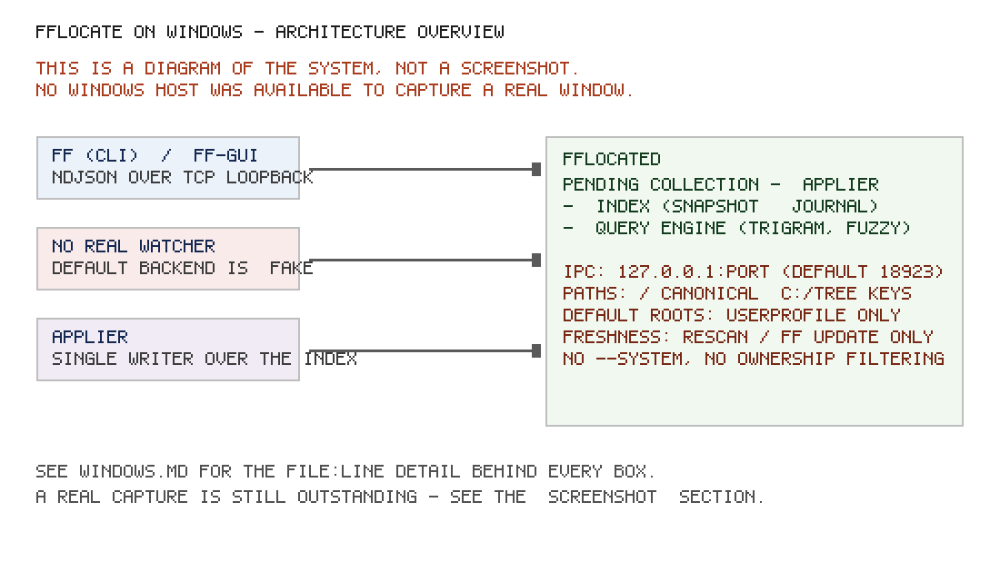

# fflocate on Windows

What the Windows port (`x86_64-pc-windows-msvc`) actually does, what it does with
caveats, and what it does not do. The project is Linux-first and macOS-second;
Windows is a **ported, merged, but minimally supported** target. This document
exists so that the gap between "it builds" and "it works" is written down
instead of discovered.



## Status at a glance

| Area | State |
|---|---|
| Build (`ff`, `fflocated`, core lib) | **works** |
| IPC (query/sync/rescan/stats/subscribe) | **works** — TCP loopback instead of unix sockets |
| Paths (`C:\tree` → `/tree` canonical) | **works**, non-UTF-8 names go lossy |
| Index, query engine, trigram, fuzzy | **works** — shared code, no Windows branch |
| Real-time watching | **not implemented** — the default backend is `fake` |
| `--system` mode, ownership filtering | **not implemented** — refused / absent |
| `ff service install` | **not implemented** — loud error |
| `find -user/-group/-perm/-inum/-links` | **not supported** — loud error, never silent |
| `ff-gui` | **unverified** — no CI, no runtime validation, no icons |
| CI | **Windows is not in CI at all** |

The last row matters more than it looks: every Windows claim in `STATUS.md`
rests on a one-off validation on real Windows 11 hardware, not on an automated
gate. Nothing here regresses loudly if Windows breaks.

## Screenshot

**There is no Windows screenshot, and none can be honestly produced from this
repository.** No Windows host was available, the GUI has no Windows runtime
tests, and CI does not build it. The image above is a diagram of the
architecture, and says so in its own caption.

To add a real capture, run on Windows:

```powershell
cargo build --release -p ff-gui
.\target\release\fflocated.exe --root $env:USERPROFILE
.\target\release\ff-gui.exe
```

Note the `.exe` suffixes: `ff --gui` does not currently look for them (see
[Known gaps](#known-gaps)).

## Architecture

The clients (`ff`, `ff-gui`) talk NDJSON to one daemon process, exactly as on
the other platforms. Three things differ.

### IPC: TCP loopback, not a socket file

Windows std has no unix sockets, so `crates/fflocate/src/transport.rs` aliases
`Stream`/`Listener` to `TcpStream`/`TcpListener` and keeps the **address in a
`PathBuf`** on every platform, so config, CLI flags, `FFLOCATE_SOCKET` and tests
need no platform branches (`transport.rs:1-9`, `:14-22`).

On Windows that `PathBuf` carries `127.0.0.1:PORT` text (`transport.rs:24-35`).
The port comes from `FFLOCATE_PORT`, defaulting to **18923**
(`crates/fflocate/src/config_paths.rs:156-169`).

Because there are no filesystem permissions on a loopback port, **loopback-only
binding is the access control** (`transport.rs:5-7`). There is no per-caller
identity at all: `SO_PEERCRED`'s macOS analogue `LOCAL_PEERCRED` has no Windows
counterpart, and every system-mode code path is `#[cfg(unix)]`
(`crates/fflocated/src/net.rs:143-221`). `--system` is refused outright
(`crates/fflocated/src/main.rs:122-126`).

One Winsock trap is worth recording because it cost every second request: an
accepted socket **inherits the listener's non-blocking mode on Windows** (the
opposite of POSIX), so the non-blocking accept loop handed `serve_client` sockets
whose first idle read failed with `WouldBlock`, closing the connection and
sending RST. Accepted streams are now forced blocking; the fix is harmless on
unix (`net.rs:1095-1120`).

`flock` does not exist, so the pidfile is only a record and **the TCP bind is the
mutual exclusion** (`net.rs:650-669`). Consequently `ff`'s deaf-daemon detector
never fires on Windows (`spawn.rs:66-88`).

### Paths

`util::normalize_separators` turns `\` into `/` **only on Windows**
(`crates/fflocate/src/util.rs:25-31`), and it runs at root ingestion
(`crates/fflocate/src/roots.rs:141-148`) and in `ff find`'s base resolution
(`crates/fx/src/find.rs:255-283`). The index stays `/`-canonical, so `C:\tree`
is keyed as `C:/tree`.

Drive roots collapse to the drive letter: `D:/` and `D:` both produce the
root-entry name `D:` (`roots.rs:174-186`, pinned by tests at `:325-327`).

State and config live under `LOCALAPPDATA` (then `APPDATA`), and the home
default comes from `USERPROFILE` (`config_paths.rs:37-86`,
`crates/fflocated/src/config.rs:283-297`).

Verbatim `\\?\` prefixes are stripped in `find` (`crates/fx/src/find.rs:285-296`)
and by the e2e helpers, but **not** in the ordinary query path — the index never
stores such a prefix, so this is believed to be harmless, but it is untested.

### Roots

There is **no drive enumeration** on Windows: no `GetLogicalDrives`, no
`GetLogicalDriveStrings` anywhere in the tree. With no `--root` and no
`$FFLOCATE_ROOT`, a Windows daemon indexes **`%USERPROFILE%` only**
(`config.rs:268-281`; the drive/discovery branch is
`#[cfg(any(target_os = "linux", target_os = "macos"))]`). Index other drives
explicitly:

```powershell
fflocated.exe --root D:\projects --root $env:USERPROFILE
```

## Freshness: there is no watcher

This is the most important difference from Linux and macOS.

**No `ReadDirectoryChangesW` backend exists.** The only platform backends are
inotify and fanotify (Linux) and FSEvents (macOS); everything else gets the
`fake` backend (`crates/fflocate/src/watch/mod.rs:20-46`). On Windows the default
is `fake` (`config.rs:145-150`), with the comment that a kernel watcher is future
work.

What `fake` does on Windows is **not** polling for arbitrary changes. It drains
an in-memory queue and additionally runs `scan_cookie_events`, which does one
non-recursive `read_dir` per watched directory looking for `.fflocate-cookie-*`
files, so that `sync` can complete (`crates/fflocate/src/watch/fake.rs:109-135`,
`:171-183`).

The consequences:

* **Real creates, deletes and renames are never observed.** The index only
  changes on the initial crawl, an explicit `ff rescan`, or `ff update`.
* A root's state of `ok` means **quiescent**, not **caught up**. The sound
  operation on Windows is `ff update`, which rescans and then syncs.
* The watcher thread would otherwise spin (the fake poll returns instantly), so
  it sleeps 50 ms when idle.

Treat a Windows index as a periodic snapshot, not a live mirror.

## Root-gone detection

`mount::probe_dev` returns `None` on Windows (no stable volume id through
stable std), so the mount watchdog cannot compare device ids. It was extended to
also alarm when a root's path stops existing — on Windows that existence check
is the *only* root-gone signal (`crates/fflocated/src/daemon.rs:1070-1075`,
`crates/fflocate/src/mount.rs:355-363`).

Caveat that follows directly: a root on a removable volume whose path still
resolves is not detected. Volume identity *is* available through
`windows-sys` (`crates/fflocate/src/drive.rs:232-353`) and is used for the
drive-change rescan, but it is not plumbed into the watchdog's device check.

## What is refused loudly

The file's rule is that an unsupported option must error, never be silently
ignored. On Windows:

* `find -perm -user -group -inum -links` → `find: <flag> is not supported on
  Windows (no unix identity metadata)`, exit 2 (`crates/fx/src/find.rs:336-349`).
  All other `find` predicates behave identically to other platforms.
* `--system` → `--system is only supported on unix`
  (`crates/fflocated/src/main.rs:122-126`).
* `ff service install` → `service install is only implemented for Linux and
  macOS` (`crates/fx/src/service.rs:95-102`). `ff service unit` prints an empty
  line rather than an error (`service.rs:117-121`).
* `--backend inotify` / `fanotify` / `fsevents` → named errors saying which
  platforms they belong to (`crates/fflocated/src/daemon.rs:158-183`).

Ownership filtering does not exist on Windows in any form: the
`crates/fflocate/src/ownership.rs` machinery compiles, but nothing supplies a
caller identity.

## GUI

`ff-gui` targets the `nwg` (native-windows-gui) backend of the vendored
`rswidgets` (`crates/ff-gui/src/main.rs:63-72`), with a Common-Controls v6
manifest embedded at build time — without it the exe dies at startup with
`0xC0000139` (`crates/ff-gui/build.rs:1-13`). Row actions use Windows shell
commands (`cmd /c start`, `explorer /select,`) (`crates/ff-gui/src/lib.rs:2380-2415`).

**Unverified.** There are no Windows GUI tests, no Windows GUI job, and the
`STATUS.md` Windows section does not mention the GUI. The source is annotated
"must compile there", which is an intention, not evidence. There are also no
per-file icons on Windows — `set_icon` exists only for GTK and AppKit.

## Known gaps

Found while writing this document; all are **open**:

1. **`ff --gui` does not find `ff-gui.exe`.** `sibling_binary` searches for the
   literal name `ff-gui` and splits `PATH` on `:`, unlike
   `spawn::daemon_binary_path`, which is `.exe`-aware
   (`crates/fx/src/main.rs:312-355`). Workaround: set `FF_GUI_BIN`.
2. **No graceful shutdown.** `install_signal_handlers` is a no-op on Windows, so
   Ctrl-C terminates without draining; the journal replays on next start. The
   pidfile is left behind (harmless — it is not lock-checked)
   (`crates/fflocated/src/main.rs:269-292`).
3. **No drive enumeration**, hence `%USERPROFILE%`-only defaults.
4. **No real watcher**, hence snapshot semantics (above).
5. **`ff service unit` prints a blank line** instead of an error.
6. **Windows is absent from CI**, so none of the above is guarded.

## Tests

The test suites are Windows-aware even though CI never runs them:

* e2e harnesses allocate an OS-assigned loopback port (`127.0.0.1:0`) and pass
  its text as the "socket" (`crates/fflocated/tests/daemon_e2e.rs:10-28`, and the
  same helper in `fault_crash.rs`, `fault_fsops.rs`, `subscribe_live.rs`,
  `crates/fx/tests/{locate,update}_e2e.rs`).
* Binary names are `EXE_SUFFIX`-aware, and the `locate` tests **copy** the
  binary to `locate.exe` rather than symlinking it
  (`crates/fx/tests/locate_e2e.rs:14-24`, `:119-128`).
* The GTK/GUI interaction suites are `#![cfg(unix)]`; the macOS suites are
  `#![cfg(target_os = "macos")]`. Neither runs on Windows.
* Socket waits are file-existence polls against a `127.0.0.1:PORT` string, which
  never exists, so each wait burns its full timeout — roughly 30 s per e2e
  suite. A TCP-probe wait would fix it.

## Platform comparison

| | Linux | macOS | Windows |
|---|---|---|---|
| IPC | unix socket | unix socket | TCP loopback (`18923`) |
| Default backend | fanotify / inotify | FSEvents | **none** (`fake`) |
| Default roots | every native mount | native APFS/HFS mounts | **`%USERPROFILE%`** |
| Caller identity | `SO_PEERCRED` | `LOCAL_PEERCRED` | **none** |
| `--system` | yes | yes | refused |
| Service install | systemd | launchd | refused |
| Freshness | live | live (FSEvents) | **rescan / `ff update`** |
| CI | yes | yes | **no** |
